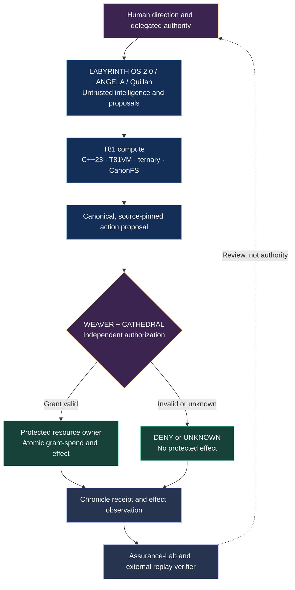

# Labyrinth OS 2.0 × T81–Weaver Nexus Systems — Architecture Visualization

**Status:** Proposed, non-authoritative
**Last Updated:** 2026-11-13
**Maturity:** Experimental
**Portfolio status:** E2 baseline / W0 / O0 WITHHELD / production prohibited

## Purpose and scope

Describe a target interoperation boundary between cognition, deterministic computation, independently authorized effects and external assurance. This is documentation, not a deployment or permission change.

## System visualization

## Implemented versus experimental boundary

This is a **conceptual cross-repository view**. It does not assert an end-to-end production integration. Labyrinth's historical source reports mock/stub stages in the live ignition path, limited structural replay and unresolved live/hardware validation. Weaver has bounded verification and CI evidence; T81 adapter compatibility and authority bypass negatives are not closed. Source maturity does not transfer across forks.

## Key invariants

1. Intelligence and T81 computation are untrusted proposal sources, never authorities.
2. Only an independently authorized resource owner writes protected effects.
3. Revoked, expired, replayed and forged grants must never commit.
4. Exact canonical bytes and revision/build pins are required for cross-project claims.
5. Receipts, actual effect observations and independent witness attestations are distinct.
6. A green local or origin-controlled CI run is not independent reproduction.

## Failure modes

Direct state bypass, revocation races, duplicate grant-spending, unknown effects after crash, symlink or traversal escape, canonical digest confusion, missing or rewritten ledger tails, stale witness checkpoints, and source/build substitution.

## Indeterminate

End-to-end enforcement, complete attack-path inventory, actual external witness custody, hardware performance and physical safety remain unverified. **No operational authority is granted by this visualization.**

## Evidence

- [Weaver architectural outline](https://github.com/ryansctt1994-sudo/Weaver_Os/blob/main/docs/architecture/UNIFIED_SYSTEM_OUTLINE.md)
- [Weaver CI](https://github.com/ryansctt1994-sudo/Weaver_Os/blob/main/.github/workflows/ci.yml)
- [T81 architecture overview](https://github.com/ryansctt1994-sudo/t81-foundation/blob/main/docs/architecture/OVERVIEW.md)
- [Digital Archaeology](https://github.com/t81dev/digital-archaeology) — upstream research reference
- Proposed demonstration: WNX-INTEGRATION-MVP-001 (not yet proven as an integrated whole).

## Acceptance criteria

- [ ] Lock source revisions, build inputs and canonical contract fixtures.
- [ ] Reproduce all security-negative cases on a disposable hosted runner.
- [ ] Record PASS, FAIL and UNTESTED counts separately.
- [ ] Prove a protected effect cannot be committed through reviewed bypass paths.
- [ ] Reconcile crash/restart UNKNOWN_EFFECT outcomes with independent observations.
- [ ] Obtain a separately controlled fresh extraction and reproduction before advancing witness status.
